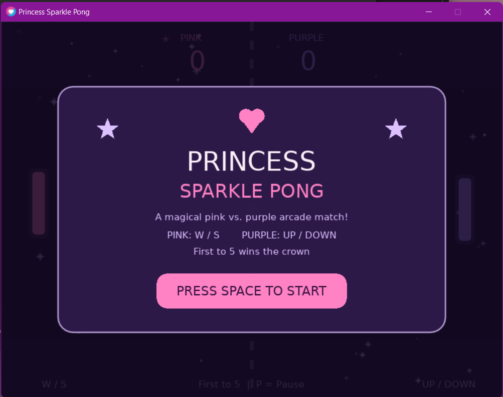
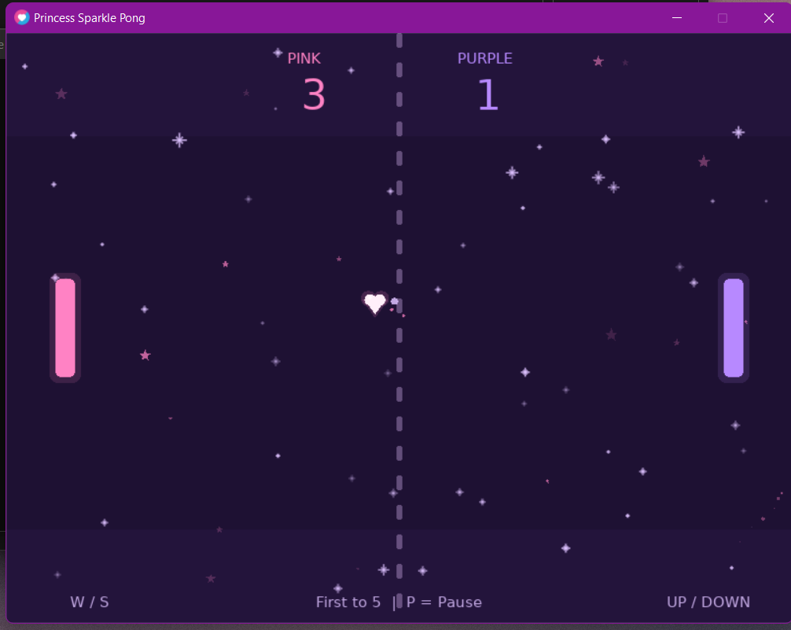
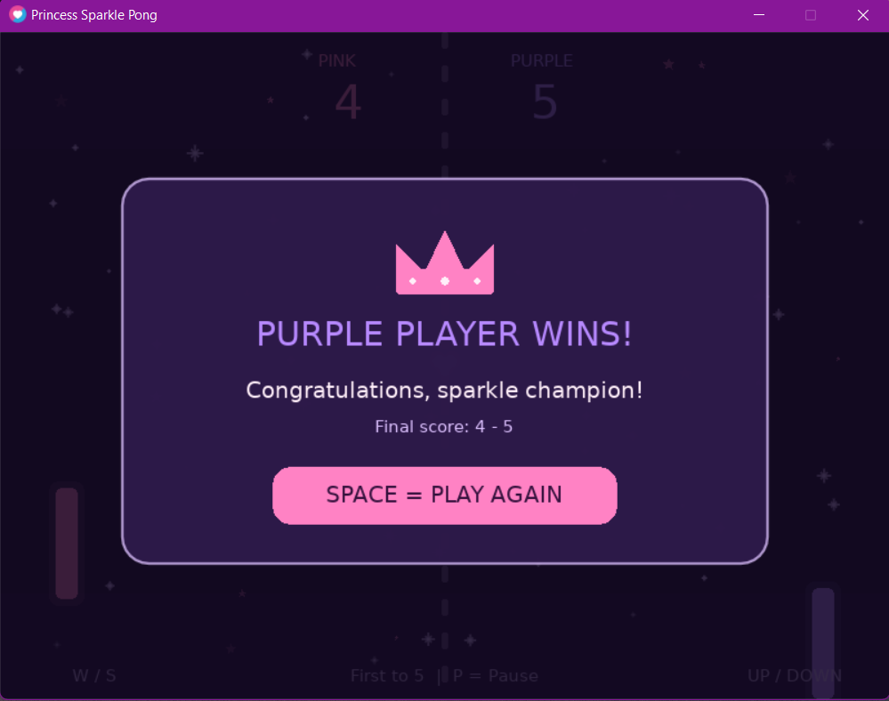

# ✨👑 Princess Sparkle Pong 💗

**A magical pink-and-purple twist on the classic Pong game, built with Lua and LÖVE2D.**

**Student:** Sana Saleh  
**Class / Section:** [Artificial Intelligence and Games / Monday & Wednesday | 8:00 AM – 10:00 AM]

## 🎮 About the Game

Princess Sparkle Pong is a two-player arcade game inspired by classic Pong. Player 1 controls a pink paddle using **W/S**, while Player 2 controls a purple paddle using the **Up/Down arrow keys**. A heart-shaped ball travels across the screen and bounces off the walls and paddles. Each time a player misses the ball, the other player earns a point and the ball resets to the center. The first player to reach **5 points** wins the crown! The game uses delta time for consistent movement, AABB rectangle collision detection, and an original pink-and-purple visual theme with twinkling stars and particle effects.

## 🕹️ Controls

| Key | Action |
| --- | --- |
| `W` / `S` | Move the **pink** (left) paddle up / down |
| `↑` / `↓` | Move the **purple** (right) paddle up / down |
| `Space` | Start the game, resume when paused, or play again after winning |
| `P` | Pause / resume |
| `Esc` | Quit |

## 🚀 How to Run

1. Install **LÖVE2D 11.x** from [love2d.org](https://love2d.org/).
2. Clone or download this repository and open its `pong-love2d` project folder.
3. Open a terminal **inside that folder** (the same folder containing `main.lua`).
4. Run:

   ```bash
   love .
   ```

   On Windows, if `love` is not recognized, use the installed LÖVE2D executable or add it to your PATH. For a default installation, a possible command in PowerShell is:

   ```powershell
   & "C:\Program Files\LOVE\love.exe" .
   ```

No additional images, fonts, or sound files are required for the game: the shapes and visual effects are drawn with LÖVE2D.

## ✨ My Own Changes / Custom Features

To make the project different from the tutorial, I designed a **Princess Sparkle** theme and added multiple custom features:

- 🎀 **Pink vs. Purple:** Each player has a distinct pastel-colored paddle and score.
- 💗 **Heart Ball:** The ball is drawn as a heart while retaining a square AABB collision box.
- ✨ **Sparkle Trail:** Small fading particles follow the moving heart.
- 🌟 **Magic Hit:** A burst of colorful particles appears when the ball hits a wall or paddle.
- 💜 **Animated Stars:** The background features gently twinkling stars and sparkles.
- 🎮 **Welcome Screen:** Press `Space` to begin the match.
- 👑 **Winner Screen:** The first player to score 5 points sees a winner announcement and can play again.
- ⏸️ **Pause / Resume:** Press `P` to pause or continue the game.

The ball also **speeds up by 5% horizontally after each paddle hit**, with a cap of 520 pixels per second, and returns to its starting speed after a point.

## 🧠 Core Game Concepts

- **`love.load()`** initializes the window, paddles, ball, fonts, and effects.
- **`love.update(dt)`** updates positions based on elapsed time (`dt`) and handles input, collisions, and scoring.
- **`love.draw()`** draws the game field and screens.
- **AABB collision detection** checks whether the ball's rectangular hitbox overlaps a paddle. On contact, its horizontal direction reverses and its position is corrected to avoid getting stuck.

## 📸 Screenshot

### 🎀 Welcome Screen


### 💗 Gameplay


### 👑 Winner Screen


## 🎬 Gameplay Demo

Watch Princess Sparkle Pong in action! 💗✨

[🎥 Watch the Gameplay Demo](demo/pong-demo.mp4.mp4)

## 📂 Project Structure

```text
pong-love2d/
├── main.lua             # Gameplay, movement, AABB collisions, scoring
├── effects.lua          # Heart drawing, stars, sparkle trail, magic hits
├── screens.lua          # Welcome screen, scoreboard, pause, winner screen
├── README.md            # Project documentation
├── screenshots/
│   └── gameplay.png     # Actual running-game screenshot (add before submission)
└── demo/
    └── pong-demo.mp4    # Actual short gameplay recording (add before submission)
```

---

Made with 💗 using **Lua + LÖVE2D**.
